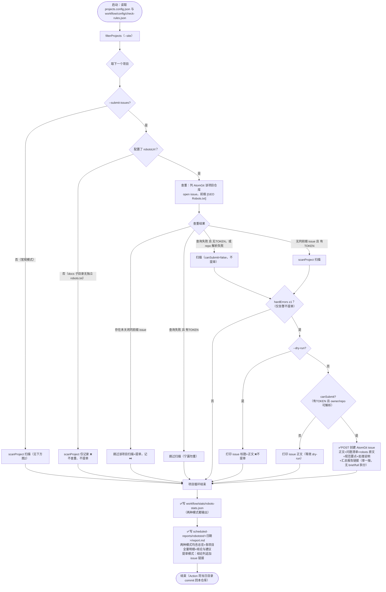
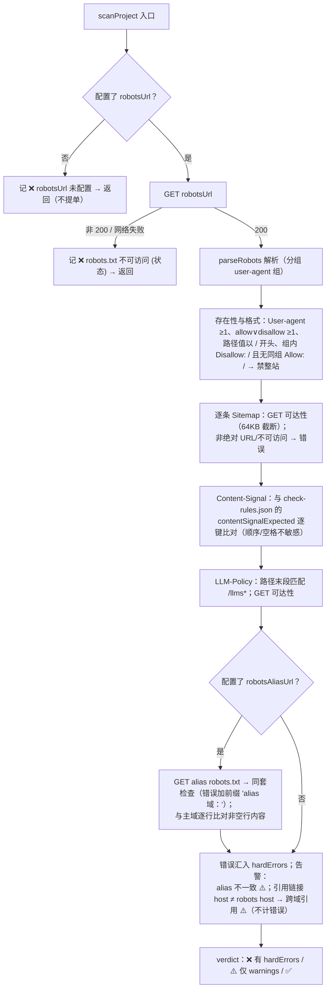

# robots.txt 工具与脚本

## 相关脚本

| 脚本 | 路径 | 功能 | 使用方式 |
|------|------|------|----------|
| check-robots | workflow/scripts/check-robots.mjs | 完整规范检查并自动生成 md 报告：可访问性（主域+alias）、User-agent、allow/disallow 存在性与路径起始斜杠、整站封锁判定、Sitemap/LLM-Policy 链接可达、Content-Signal 取值比对（规则见 config/check-rules.json 的 `robots.contentSignalExpected`）、LLM-Policy 指向 llms.txt、主域/alias 内容一致性、跨域引用告警；输出 stats JSON + `scheduled-reports/robotstxt/YYYY-MM-DD/report.md`，每项目给出 hardErrors/warnings/verdict；`--submit-issues` 时按查重结果向各项目 AtomGit 仓库提 issue（前缀 `[GEO Robots.txt]`，正文为完整明细单一版，不做简短/完全双报告） | `node workflow/scripts/check-robots.mjs` |

## GitHub Action

- `.github/workflows/robots-txt-check.yml`：每日 04:00 UTC 定时 + 手动 dispatch（inputs：`site`、`dry_run`）；`--submit-issues` 模式运行，需 secrets.ATOMGIT_TOKEN；当日报告 commit 回本仓库

## 使用说明

```bash
# 检查所有项目（常规，不提单）
node workflow/scripts/check-robots.mjs

# 检查单个项目
node workflow/scripts/check-robots.mjs --site=openEuler-portal

# 扫描并向各项目 AtomGit 仓库提 issue（本地无 ATOMGIT_TOKEN 时自动降级为只扫描打印正文）
ATOMGIT_TOKEN=xxx node workflow/scripts/check-robots.mjs --submit-issues

# 试运行：扫描 + 打印 issue 正文，不创建 issue
node workflow/scripts/check-robots.mjs --submit-issues --dry-run --site=HiFloat
```

## check-robots 参数

### CLI 参数

| 参数 | 缺省值 | 含义 |
|------|--------|------|
| `--site=<项目ID>` | 不传 = 全部项目 | 只检查指定 id 的项目（大小写不敏感）。注意：id 不存在时 `filterProjects` 回退为全量检查 |
| `--submit-issues` | 关闭 | 提 issue 模式：逐项目先查重（AtomGit 仓库标题前缀 `[GEO Robots.txt]` 的未关闭 issue）→ 命中则跳过该项目"扫描+提单"；未命中则扫描，hardErrors ≥1 时提单。本维度**不写 brief/full 双报告**（单项目明细短，issue 正文直接内嵌完整明细）；汇总 report.md 两种模式都含全量明细，提单模式额外在结论列附 issue 链接 |
| `--dry-run` | 关闭 | 仅配合 `--submit-issues` 有意义：绝不提单，只把将要提交的 issue 标题与正文打印到控制台（汇总/stats 照常输出） |
| （无 `--skip`） | — | robots.txt 检查为轻量抓取（每项目 1~8 个 URL），无需跳过清单；未配置 `robotsUrl` 的项目（docs 子目录）照常扫描记 ❌ 但不查重、不提单 |

### 环境变量

| 变量 | 缺省 | 作用 |
|------|------|------|
| `ATOMGIT_TOKEN` | 未设置 | AtomGit 写操作凭证。未设置时所有项目 `canSubmit=false`：本地试跑只会扫描+打印正文，**不会提单**；提单模式查重失败时（无 token）也降级为仅扫描 |
| `GITHUB_REPOSITORY` | `opensourceways/daily-check-workflow` | issue 正文尾部当日汇总报告链接的仓库路径 |
| `GITHUB_REF_NAME` | `archive` | 链接中的分支名（GitHub Actions 运行时自动注入实际值） |

## check-robots 执行流程



单项目扫描内部（scanProject，两种模式共用）：



> 触发提单条件 `hasAnyIssue` = 配置了 robotsUrl 且 hardErrors ≥1（robots.txt 不可访问计错误）；仅告警（主域/alias 不一致、跨域引用）与 robotsUrl 未配置不触发提单。

## 输出

- 脚本结果：`workflow/stats/robots-stats.json`（每项目含 checks（主域）、alias（alias 域）、aliasConsistent、hardErrors、warnings、verdict）
- Markdown 报告（脚本自动生成）：`scheduled-reports/robotstxt/YYYY-MM-DD/report.md`（总览表 + 各项目明细 + 结论与建议）
- 2026-10-12 首轮人工核查报告：`manual-review/issues/robotstxt/robots-spec-report-2026-10-12.md`（历史快照，同等检查已并入脚本）

## 尚未自动化的检查

- disallow/allow 值"引用目录须以 `/` 结尾"的目录语义判定
- UnifiedBus disallow 规则是否误伤正常页面、文档子目录是否需要独立 robots.txt（业务判断）
