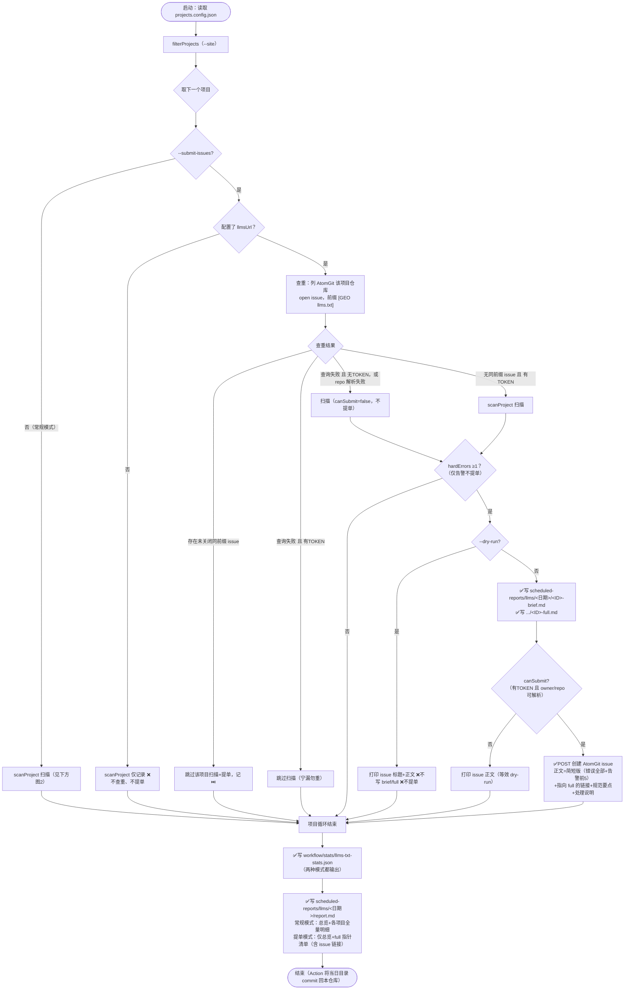
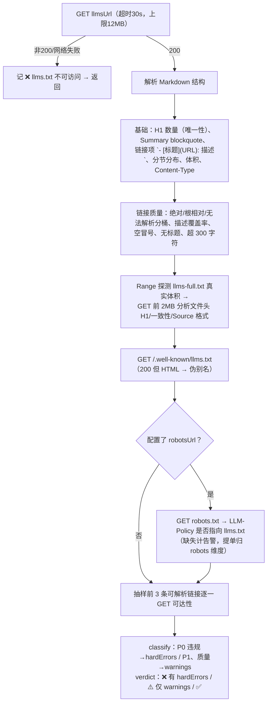

# llms.txt 工具与脚本

> 本维度**问题扫描脚本**（例行检查 + 提 issue）如下；项目侧如何落地生成 llms.txt（VitePress/Nuxt 插件、skill 兜底脚本、上线验收）见 [实现方式](实现方式.md)。

## 相关脚本

| 脚本 | 路径 | 功能 | 使用方式 |
|------|------|------|----------|
| check-llms-txt | workflow/scripts/check-llms-txt.mjs | llms.txt 规范巡检并自动生成 md 报告：可访问性、Content-Type、H1/Summary、分节与链接结构（URL 可解析）、描述覆盖率（≥80%）与空冒号/无标题/超 300 字符、单节链接数（建议 5–20）、100k 体积、llms-full.txt（可达/文件头一致性/Source 格式，Range 实测体积 + 前 2MB 截断分析）、HTTP 发现头、.well-known 别名（含伪别名识别）、robots LLM-Policy 联动、抽样前 3 链接可达；输出 stats JSON + `scheduled-reports/llms/YYYY-MM-DD/report.md`，每项目给出 hardErrors/warnings/verdict；`--submit-issues` 时按查重结果向各项目 AtomGit 仓库提 issue（前缀 `[GEO llms.txt]`，brief/full 双报告） | `node workflow/scripts/check-llms-txt.mjs` |
| atomgit 客户端 | workflow/lib/atomgit.mjs | AtomGit API v5 轻量封装（列 issue/按前缀查重/建 issue/评论），零依赖基于全局 fetch | 供 `--submit-issues` 模式使用 |

## 使用说明

```bash
# 检查所有项目（常规，不提单）
node workflow/scripts/check-llms-txt.mjs

# 检查单个项目
node workflow/scripts/check-llms-txt.mjs --site=openEuler-portal

# 扫描并向各项目 AtomGit 仓库提 issue（本地无 ATOMGIT_TOKEN 时自动降级为只扫描打印正文）
ATOMGIT_TOKEN=xxx node workflow/scripts/check-llms-txt.mjs --submit-issues

# 试运行：扫描 + 打印 issue 正文，不创建 issue、不写 brief/full
node workflow/scripts/check-llms-txt.mjs --submit-issues --dry-run --site=HiFloat

# 或在 workflow 目录下用 package.json 别名
pnpm check:llms
```

## check-llms-txt 参数

### CLI 参数

| 参数 | 缺省值 | 含义 |
|------|--------|------|
| `--site=<项目ID>` | 不传 = 全部项目 | 只检查指定 id 的项目（大小写不敏感）。注意：id 不存在时 `filterProjects` 回退为全量检查 |
| `--submit-issues` | 关闭 | 提 issue 模式：逐项目先查重（AtomGit 仓库标题前缀 `[GEO llms.txt]` 的未关闭 issue）→ 命中则跳过该项目"扫描+提单"；未命中则扫描，hardErrors ≥1 时写 `<ID>-brief.md`/`<ID>-full.md` 并提单；汇总 report.md 切换为"仅总览 + full 指针（含 issue 链接）"，不重复输出明细 |
| `--dry-run` | 关闭 | 仅配合 `--submit-issues` 有意义：不写 brief/full、绝不提单，只把将要提交的 issue 标题与正文打印到控制台（汇总/stats 照常输出） |
| （无 `--skip`） | — | llms.txt 检查为轻量抓取（每项目 2~8 个 URL：llms.txt、llms-full.txt（截断 2MB）、.well-known、robots、抽样 3 链接），无需跳过清单；未配置 `llmsUrl` 的项目照常扫描记 ❌ 但不查重、不提单 |

### 环境变量

| 变量 | 缺省 | 作用 |
|------|------|------|
| `ATOMGIT_TOKEN` | 未设置 | AtomGit 写操作凭证。未设置时所有项目 `canSubmit=false`：本地试跑只会扫描+打印正文，**不会提单**；提单模式查重失败时（无 token）也降级为仅扫描 |
| `GITHUB_REPOSITORY` | `opensourceways/daily-check-workflow` | issue 正文中完全版报告链接的仓库路径 |
| `GITHUB_REF_NAME` | `archive` | 链接中的分支名（GitHub Actions 运行时自动注入实际值） |

## 判定分级（错误/告警）

对齐 [规范](规范.md) 验收基线：

- **硬性错误（P0，触发提单）**：llms.txt 不可访问、Content-Type 非 `text/plain`/`text/markdown`、H1 缺失或不唯一、Summary 缺失、无链接项、无 `##` 分节、存在无法解析的链接 URL（既非绝对也非根相对）、体积超 100,000 字符
- **告警（P1/质量项，仅入报告不提单）**：llms-full.txt 不可达/文件头缺失或与 llms.txt 不一致/缺 Source URL 或非绝对、描述覆盖率 <80%、空冒号/无标题/超 300 字符描述、单节链接超 20、`Link: rel="describedby"` 发现头缺失、.well-known 伪别名（200 返回 HTML）、抽样链接不可达、robots LLM-Policy 未联动（**提单归 01-robots-txt 维度，避免同根因跨维度重复提单**）
- **P2 可选项**（.well-known 缺失、`X-Llms-Txt` 头）：只记数据不记告警

## check-llms-txt 执行流程



单项目扫描内部（scanProject，两种模式共用）：



> 触发提单条件 `hasAnyIssue` = 配置了 llmsUrl 且 hardErrors ≥1；仅告警与 llmsUrl 未配置不提单。

## GitHub Action

- 编排：`.github/workflows/llms-txt-check.yml`
- 触发：每日 05:00 UTC（北京时间 13:00）schedule + workflow_dispatch（inputs：`site`、`dry_run`）
- 运行：`node scripts/check-llms-txt.mjs --submit-issues`，env `ATOMGIT_TOKEN: ${{ secrets.ATOMGIT_TOKEN }}`
- 产物回写：`scheduled-reports/llms/<YYYY-MM-DD>/`（report.md 与各项目 brief/full）由 Action commit 回本仓库，issue 内完全版报告链接据此解析
- 注意：schedule cron 仅在默认分支（main）生效

## 输出

- 汇总报告：`scheduled-reports/llms/YYYY-MM-DD/report.md`（按日期分目录；手动模式含全部明细，`--submit-issues` 模式仅含总览 + 指向各项目完全版文件的清单）
- 机器可读结果：`workflow/stats/llms-txt-stats.json`（每项目含 checks 全量字段、hardErrors、warnings、verdict、mode）
- `--submit-issues` 模式额外输出（每项目，仅当发现 P0 硬性错误）：`scheduled-reports/llms/<日期目录>/<ID>-brief.md`（简短版，issue 正文用）与 `<ID>-full.md`（完全版，含全部错误/告警与逐项检查明细表，issue 链接指向它，由 workflow 提交回仓库）

## 尚未自动化的检查

- 内容准确性（把 llms.txt 单独交给 AI 助手能否正确回答站点核心问题）
- 分节组织与重要性排序合理性、描述是否取自页面 frontmatter（禁止编造）
- 是否混入 noindex/hidden/404 页面（见 [检测方式](检测方式.md) 人工检查要点）
