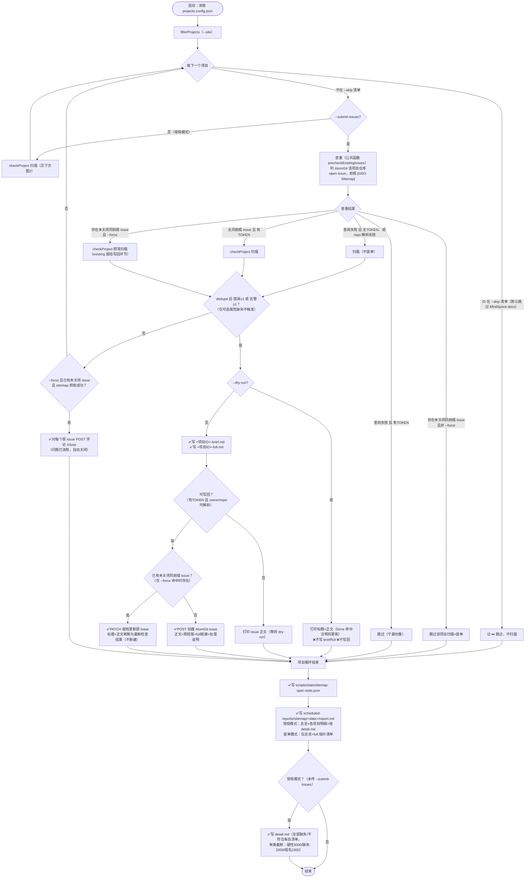
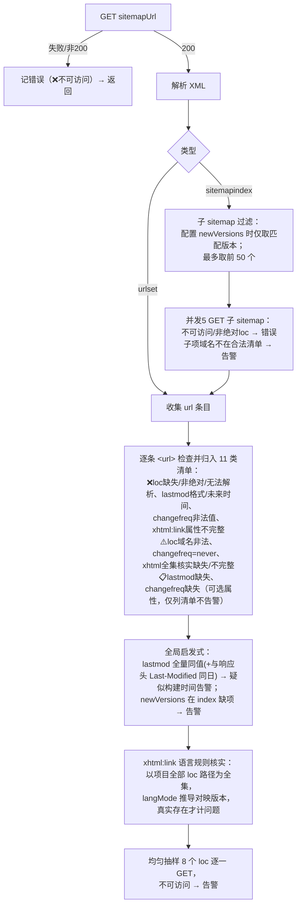

# Sitemap 工具与脚本

## 相关脚本

| 脚本 | 路径 | 功能 | 使用方式 |
|------|------|------|----------|
| sitemap-spec-check（当前主要） | scripts/checks/sitemap-spec-check.mjs | sitemap 属性规范检查：urlset/index 递归解析（子 sitemap 可访问性、newVersions 过滤）、loc 绝对性与合法域名清单（domain/domainAlias/sitemapUrl/sitemapAliasUrl）、lastmod W3C 格式/未来时间/构建时间启发式、changefreq 枚举与 never、xhtml:link 按语言路径规则 + 页面全集核实；`--submit-issues` 模式按前缀 `[GEO Sitemap]` 查重后提单到各项目 AtomGit 仓库 | 常规：`node scripts/checks/sitemap-spec-check.mjs`；提单：`node scripts/checks/sitemap-spec-check.mjs --submit-issues` |
| check-sitemap（旧版轻量快查） | scripts/checks/check-sitemap.mjs | 单次抽样统计（JSON），口径较粗，规范判定以 sitemap-spec-check 为准 | `node scripts/checks/check-sitemap.mjs --site=<项目id>` |

## 使用说明

```bash
# 常规规范检查（默认跳过 MindSpore-docs；--skip= 传空强制全查）
node scripts/checks/sitemap-spec-check.mjs

# 单项目
node scripts/checks/sitemap-spec-check.mjs --site=HiFloat

# 提 issue 模式（需 ATOMGIT_TOKEN；未关闭同前缀 issue 存在时该项目跳过扫描与提单）
ATOMGIT_TOKEN=xxx node scripts/checks/sitemap-spec-check.mjs --submit-issues

# dry-run：只扫描并打印 issue 正文，不写 brief/full、不提单（本地无 token 也只会打印）
node scripts/checks/sitemap-spec-check.mjs --site=HiFloat --submit-issues --dry-run

# 强制执行（修复后立即复核：已有未关闭 issue 不再跳过，仍有问题更新原 issue，已无问题评论 /close）
node scripts/checks/sitemap-spec-check.mjs --submit-issues --force --site=HiFloat

# 或在仓库根用 package.json 短命令
pnpm check:sitemap-spec

# 旧版快查（单项目）
node scripts/checks/check-sitemap.mjs --site=openEuler-portal
```

## sitemap-spec-check 参数

### CLI 参数

| 参数 | 缺省值 | 含义 |
|------|--------|------|
| `--site=<项目ID>` | 不传 = 全部项目 | 只检查指定 id 的项目（大小写不敏感）。注意：id 不存在时 `filterProjects` 回退为全量检查 |
| `--skip=<id1,id2>` | 不传 = 默认跳过 `MindSpore-docs`（其 sitemapUrl 当前 404） | 跳过清单（逗号分隔，大小写不敏感）；被跳过项目只进报告记 ⏭️，不扫描、不提单。`--skip=` 传空 = 取消默认跳过，强制全查 |
| `--submit-issues` | 关闭 | 提 issue 模式：逐项目先查重（AtomGit 仓库标题前缀 `[GEO Sitemap]` 的未关闭 issue）→ 命中且**非** `--force` 跳过该项目扫描+提单；否则扫描 → 命中问题写 `<id>-brief.md`/`<id>-full.md` 并提单；report.md 切换为"仅总览 + full 指针"的简版，且不写 detail.md |
| `--dry-run` | 关闭 | 仅配合 `--submit-issues` 有意义：不写 brief/full、绝不提单，只把将要提交的 issue 标题与正文打印到控制台（汇总/ stats 照常输出） |
| `--force` | 关闭 | 仅配合 `--submit-issues` 有意义（对应 workflow 的 `force_check` 输入）：**强制执行**——查重命中已有未关闭 issue 时不再跳过，照常扫描：① 仍有错误/告警 → 就地 PATCH 更新原 issue 标题与正文（不新建）；② 问题已消除且 sitemap 抓取成功（有效复检）→ 对每个原未关闭 issue 评论 `/close` 自动关闭。dry-run/无 token 仅打印将执行的动作 |

### 环境变量

| 变量 | 缺省 | 作用 |
|------|------|------|
| `ATOMGIT_TOKEN` | 未设置 | AtomGit 写操作凭证。未设置时所有项目 `canSubmit=false`：本地试跑只会扫描+打印正文，**不会提单**；提单模式查重失败时（无 token）也降级为仅扫描 |
| `GITHUB_REPOSITORY` | `opensourceways/daily-check-workflow` | issue 正文中完全版报告链接的仓库路径 |
| `GITHUB_REF_NAME` | `archive` | 链接中的分支名（GitHub Actions 运行时自动注入实际值） |

## sitemap-spec-check 执行流程



单项目扫描内部（checkProject，两种模式共用）：



> 触发提单条件 `hasAnyIssue` = 去重后的错误数或告警数 ≥1（sitemap 不可访问算错误）；仅 lastmod/changefreq 等可选属性"缺失"不触发。

## GitHub Action

- 编排：`.github/workflows/sitemap-spec-check.yml`
- 触发：每日 04:30 UTC（北京时间 12:30）schedule + workflow_dispatch（inputs：`site`、`dry_run`、`force_check`——勾选后透传 `--force` 强制执行，跳过查重拦截并写回原 issue）
- 运行：`node scripts/sitemap-spec-check.mjs --submit-issues`，env `ATOMGIT_TOKEN: ${{ secrets.ATOMGIT_TOKEN }}`
- 产物回写：`scheduled-reports/sitemap/<YYYY-MM-DD>/`（汇总/明细或 brief/full）由 Action commit 回本仓库，issue 内完全版报告链接据此解析
- 注意：schedule cron 仅在默认分支（main）生效，archive 分支期间用 workflow_dispatch 验证

## 输出

脚本直接写入报告归档目录 `scheduled-reports/sitemap/<YYYY-MM-DD>/`（按日期分目录；2026-10-13 及以前的历史报告保留平铺旧位于 `manual-review/issues/sitemap/`，已提 issue 链接不受影响）：

| 文件 | 内容 |
|------|------|
| scheduled-reports/sitemap/YYYY-MM-DD/report.md | 总览表 + 各项目明细（常规模式含分类计数与错误/告警/特殊约定说明，并链接明细文件；`--submit-issues` 模式仅保留总览 + 指向各项目 full 文件的清单，避免明细重复） |
| scheduled-reports/sitemap/YYYY-MM-DD/detail.md | 缺失/不符合条目完整清单，按项目、属性分类；单类超上限截断并注明总数（硬性错误 3000、缺失类 2000、域名不一致 1000）。仅常规模式输出 |
| scheduled-reports/sitemap/YYYY-MM-DD/<项目ID>-brief.md / <项目ID>-full.md | 提 issue 模式：每个发现问题项目的简短版（每类最多 5 个示例）与完全版（issue 正文链接指向 full）。`--dry-run` 时不写 |
| scripts/stats/sitemap-spec-stats.json | 机器可读结果（两种模式都输出） |
| scripts/stats/sitemap-stats.json | 旧版快查脚本的统计输出 |

## 依赖的配置字段（projects.config.json）

| 字段 | 作用 |
|------|------|
| sitemapUrl | 待检查的 sitemap（urlset 或 index） |
| sitemapAliasUrl | 别名域 sitemap，其 host 计入合法域名清单 |
| domainAlias | 别名域名，其 host 计入合法域名清单（loc 指向它不算问题） |
| newVersions | index 项目仅检查匹配这些版本路径（`/` 为根）的子 sitemap；index 缺项时告警 |
| langMode（可选） | 覆盖 xhtml:link 语言路径规则：`zh-en-prefix`（默认）或 `mindspore`；缺省时按项目 id 是否含 MindSpore 推断 |

## 解析限制

- 报告生成与检查合一：脚本直接抓取现网 sitemap，不读取本地构建产物
- 子 sitemap 最多检查前 50 个（超出在报告中注明）
- xhtml:link 核实以 sitemap 收录的 URL 全集为依据，站点存在但未收录的语言版本无法发现（见 检测方式.md 人工检查要点）
