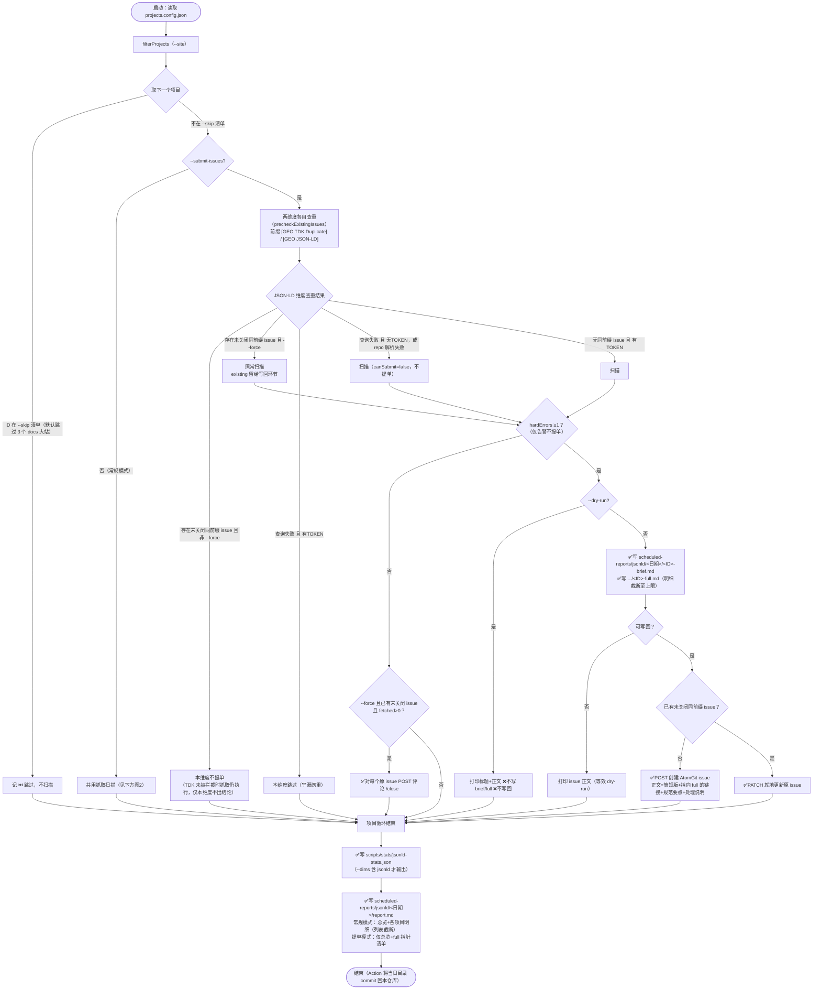
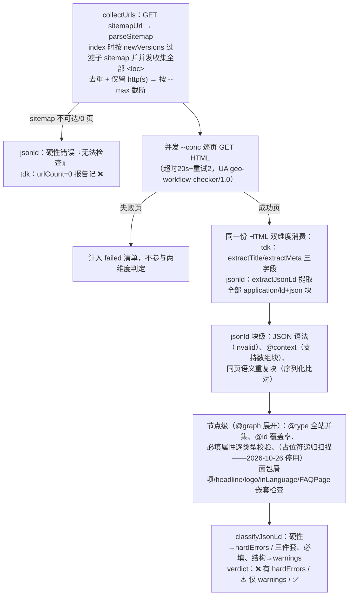

# JSON-LD 工具与脚本

> 本维度**问题扫描脚本**（例行检查 + 提 issue）如下；项目侧如何落地注入 JSON-LD（VitePress hooks、nuxt-schema-org、skill 兜底注入/校验脚本、上线验收）见 [实现方式](实现方式.md)。
> 2026-10 重构：`check-jsonld.mjs`（采样扫描）与 `check-tdk-duplicate.mjs`（TDK 全量扫描）合并为 **`check-tdk-jsonld.mjs`**——按 sitemap 全量展开页面、每页只抓一次 HTML，两维度共用抓取；本维度用 `--dims=jsonld` 单独跑，也可 `--dims=tdk,jsonld`（默认）同跑。

## 相关脚本

| 脚本 | 路径 | 功能 | 使用方式 |
|------|------|------|----------|
| check-tdk-jsonld | scripts/checks/check-tdk-jsonld.mjs | TDK 重复 + JSON-LD 规范合并全量巡检：sitemap 展开（index 递归、newVersions 过滤）→ 逐页抓取 HTML（并发 `--conc`，失败页单列）→ TDK 判重/缺失 + JSON-LD 校验（JSON 语法、`@context` 为硬性；P0 三件套、Google 必填属性、重复块、面包屑项、headline ≤110、logo 形态、inLanguage、`@id` 覆盖率为告警；占位符检查 2026-10-26 起停用，误伤待正则重设计）；输出 stats JSON + `scheduled-reports/jsonld/YYYY-MM-DD/report.md`（TDK 维度同跑时另写 `scheduled-reports/tdk/.../report.md`），每项目给出 hardErrors/warnings/verdict；`--submit-issues` 时按查重结果向各项目 AtomGit 仓库提 issue（本维度前缀 `[GEO JSON-LD]`，brief/full 双报告） | `node scripts/checks/check-tdk-jsonld.mjs --dims=jsonld` |
| jsonld 分析库 | scripts/lib/jsonld.mjs | 页面级分析器 `createJsonLdAnalyzer`（addPage 消费共用抓取的 HTML）与分级 `classifyJsonLd`；`scripts/lib/crawl.mjs` 提供 sitemap 收集与并发抓取 | 供合并脚本使用 |
| atomgit 客户端 | scripts/lib/atomgit.mjs | AtomGit API v5 轻量封装（列 issue/按前缀查重/建 issue/更新 issue PATCH/评论），零依赖基于全局 fetch；并含各维度共用的提单流程实现 `precheckExistingIssues`（查重）/`reconcileIssue`（新建·更新·评论 /close 写回） | 供 `--submit-issues` 模式使用 |

## 使用说明

```bash
# 检查所有项目（常规，不提单；两维度共用抓取）
node scripts/checks/check-tdk-jsonld.mjs

# 只跑 JSON-LD 维度
node scripts/checks/check-tdk-jsonld.mjs --dims=jsonld
# 或短命令
pnpm check:jsonld

# 检查单个项目 / 试跑截断
node scripts/checks/check-tdk-jsonld.mjs --dims=jsonld --site=openEuler-portal
node scripts/checks/check-tdk-jsonld.mjs --dims=jsonld --site=openEuler-portal --max=200 --conc=5

# 扫描并向各项目 AtomGit 仓库提 issue（本地无 ATOMGIT_TOKEN 时自动降级为只扫描打印正文）
ATOMGIT_TOKEN=xxx node scripts/checks/check-tdk-jsonld.mjs --dims=jsonld --submit-issues

# 试运行：扫描 + 打印 issue 正文，不创建 issue、不写 brief/full
node scripts/checks/check-tdk-jsonld.mjs --dims=jsonld --submit-issues --dry-run --site=HiFloat

# 强制执行（修复后立即复核：已有未关闭 issue 不再跳过，仍有问题更新原 issue，已无问题评论 /close）
node scripts/checks/check-tdk-jsonld.mjs --dims=jsonld --submit-issues --force --site=HiFloat
```

## check-tdk-jsonld（JSON-LD 维度）参数

### CLI 参数

| 参数 | 缺省值 | 含义 |
|------|--------|------|
| `--dims=<d1,d2>` | `tdk,jsonld` | 本次执行的维度；仅含 `jsonld` 时只输出 JSON-LD 的 stats/报告，TDK 维度产物不动 |
| `--site=<项目ID>` | 不传 = 全部项目 | 只检查指定 id 的项目（大小写不敏感）。注意：id 不存在时 `filterProjects` 回退为全量检查 |
| `--skip=<id1,id2>` | 不传 = 默认跳过 `openeuler-docs`、`opengauss-docs`、`mindspore-docs`（docs 大站页面量级大；与 TDK 维度共用同一清单） | 跳过清单（逗号分隔，大小写不敏感）；被跳过项目只进报告记 ⏭️，不扫描、不提单。`--skip=` 传空 = 取消默认跳过，强制全查 |
| `--conc=N` | `10` | 逐页抓取 HTML 的并发数（两维度共用） |
| `--max=N` | 不截断 | 每项目页面全集截断为前 N 个（试跑用），截断情况写入 notes 与报告 |
| `--submit-issues` | 关闭 | 提 issue 模式：逐项目先查重（AtomGit 仓库标题前缀 `[GEO JSON-LD]` 的未关闭 issue）→ 命中且非 `--force` 则本维度不产出结论不提单（若另一维度未被拦截，共用抓取照常）；未命中则扫描，hardErrors ≥1 时写 `<ID>-brief.md`/`<ID>-full.md` 并提单；汇总 report.md 切换为"仅总览 + full 指针（含 issue 链接）"，不重复输出明细 |
| `--dry-run` | 关闭 | 仅配合 `--submit-issues` 有意义：不写 brief/full、绝不提单，只把将要提交的 issue 标题与正文打印到控制台（汇总/stats 照常输出） |
| `--force` | 关闭 | 仅配合 `--submit-issues` 有意义（对应 workflow 的 `force_check` 输入）：**强制执行**——查重命中已有未关闭 issue 时不再跳过，照常扫描：① 仍有硬性错误 → 就地 PATCH 更新原 issue 标题与正文（不新建，`updated`）；② 无硬性错误且本次为有效抓取（`fetched>0`）→ 对每个原未关闭 issue 评论 `/close` 自动关闭（`close-commented`）。dry-run/无 token 仅打印将执行的动作 |

### 环境变量

| 变量 | 缺省 | 作用 |
|------|------|------|
| `ATOMGIT_TOKEN` | 未设置 | AtomGit 写操作凭证。未设置时所有项目 `canSubmit=false`：本地试跑只会扫描+打印正文，**不会提单**；提单模式查重失败时（无 token）也降级为仅扫描 |
| `GITHUB_REPOSITORY` | `opensourceways/daily-check-workflow` | issue 正文中完全版报告链接的仓库路径 |
| `GITHUB_REF_NAME` | `archive` | 链接中的分支名（GitHub Actions 运行时自动注入实际值） |

## 判定分级（错误/告警）

对齐 [规范](规范.md)；2026-10 全量化改造时的降级调整已标注：

- **硬性错误（触发提单）**：站点/sitemap 不可达（收集 0 页）、sitemap 页面全部抓取失败、整站无合法 JSON-LD 块、JSON 语法错误块、`@context` 异常（非 `https://schema.org`）；~~占位符取值（TODO/待填/占位等）~~——**2026-10-26 起停用**（`PLACEHOLDER_RE` 会误伤含 "todo/TBD" 的真实英文文案，代码注释保留、正则重设计后取消注释恢复）
- **告警（仅入报告不提单）**：~~P0 三件套缺项（Organization/WebSite/BreadcrumbList）~~（2026-10 自 P0 降级）、~~Google 必填属性缺失（如 TechArticle 的 headline/image/datePublished/author）~~（2026-10 自 P0 降级）、同页语义重复块、面包屑项缺 name/position、headline 超 110 字符、publisher/Organization logo 形态（缺失/裸字符串/相对 URL）、页面级节点缺 `inLanguage`、`@id` 覆盖率不足
- **informational**（只记数据）：`usesGraph`、`schemaTypes`（全站并集）、每页块数、`urlCount`/`fetched`/`failedCount`
- P0 三件套判定口径：全站并集——Organization/WebSite/BreadcrumbList 任一页面出现过即算存在（不要求同页/同块）

## check-tdk-jsonld（JSON-LD 维度）执行流程



单项目共用抓取内部（scanProject，两维度同跑时每页只发一次请求）：



> 触发提单条件 `hasAnyIssue` = hardErrors ≥1；三件套/必填/重复块/inLanguage/@id 覆盖率等告警不提单。抓取失败页面不计入判定（与 TDK 维度同口径）；某项目整站 0 个合法块（抓取成功但无任何 ld+json）属硬性错误。

## GitHub Action

- 编排：`.github/workflows/tdk-jsonld-check.yml`（原 json-ld-check.yml 与 tdk-duplicate-check.yml 已合并删除）
- 触发：每周一 03:30 UTC（北京时间 11:30）schedule + workflow_dispatch（inputs：`site`、`dims`（both/tdk/jsonld）、`dry_run`、`force_check`——勾选后透传 `--force` 强制执行，跳过查重拦截并写回原 issue）
- 运行：`node scripts/checks/check-tdk-jsonld.mjs --submit-issues`（默认双维度），env `ATOMGIT_TOKEN: ${{ secrets.ATOMGIT_TOKEN }}`
- 产物回写：`scheduled-reports/jsonld/<YYYY-MM-DD>/` 与 `scheduled-reports/tdk/<YYYY-MM-DD>/`（report.md 与各项目 brief/full）由 Action commit 回本仓库，issue 内完全版报告链接据此解析
- JSON-LD 频率变化：原每日（06:00 UTC）采样 → 随 TDK 每周一全量；成本与 TDK 全量一致（共用抓取，不新增请求量）
- 注意：schedule cron 仅在默认分支（main）生效

## 输出

- 汇总报告：`scheduled-reports/jsonld/YYYY-MM-DD/report.md`（按日期分目录；手动模式含明细但逐条清单截断至上限（默认 300 条/节），`--submit-issues` 模式仅含总览 + 指向各项目完全版文件的清单）
- 机器可读结果：`scripts/stats/jsonld-stats.json`（每项目含 urlCount/fetched/failedCount、perPage、pagesWithBlocks、schemaTypes、p0Missing、requiredMissing、nestedIssues、placeholderHits、contextErrors、invalidPages、duplicateBlockCount、idCoverage、hardErrors、warnings、verdict、dims/mode/scope）
- `--submit-issues` 模式额外输出（每项目，仅当发现硬性错误）：`scheduled-reports/jsonld/<日期目录>/<ID>-brief.md`（简短版，issue 正文用）与 `<ID>-full.md`（完全版：硬性问题清单与逐页明细在前——语法错误页/@context 异常，告警与明细在后——必填缺失分组计数表、结构推荐项、重复块（各列表截断至上限），只输出有问题的项；嵌入文本的 URL 结尾带空格防链接渲染吞字；issue 链接指向它，由 workflow 提交回仓库）

## 尚未自动化的检查

- 注入方式是否为 SSG/SSR（脚本抓静态 HTML 已隐含此判定，但客户端动态注入需人工查看源代码确认）
- 取值真实性（与页面可见内容一致、评分/价格/日期/作者无编造）
- 富媒体资格（Rich Results Test）与词汇合法性（validator.schema.org）抽查
- 面包屑名称与页面可见导航一致性（见 [检测方式](检测方式.md) 人工检查要点）
