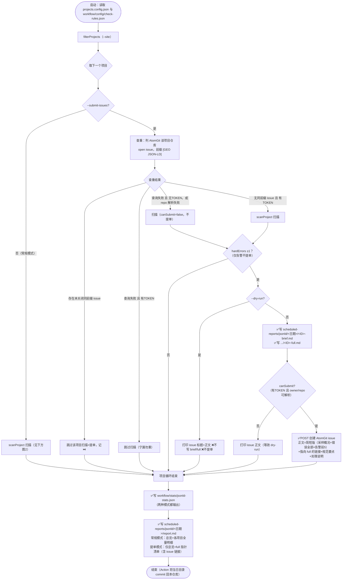
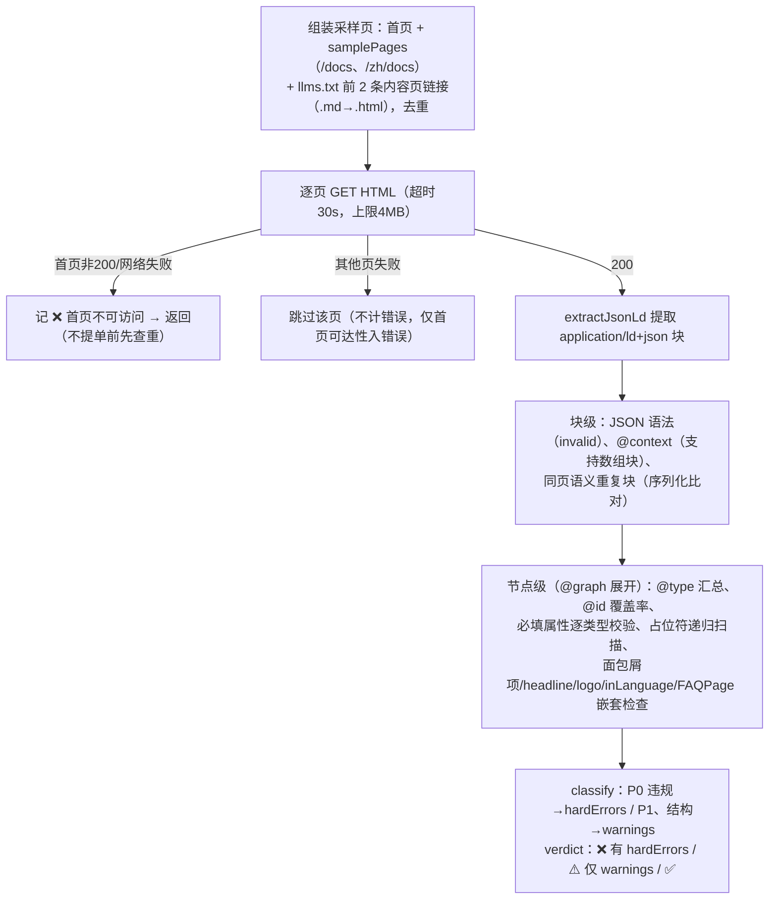

# JSON-LD 工具与脚本

> 本维度**问题扫描脚本**（例行检查 + 提 issue）如下；项目侧如何落地注入 JSON-LD（VitePress hooks、nuxt-schema-org、skill 兜底注入/校验脚本、上线验收）见 [实现方式](实现方式.md)。

## 相关脚本

| 脚本 | 路径 | 功能 | 使用方式 |
|------|------|------|----------|
| check-jsonld | workflow/scripts/check-jsonld.mjs | JSON-LD 规范巡检并自动生成 md 报告：采样首页 + `check-rules.json` 的 `samplePages` + llms.txt 前 2 条内容页，校验 JSON 语法、`@context`（支持数组块）、P0 三件套覆盖（Organization/WebSite/BreadcrumbList）、各类型 Google 必填属性、占位符、同页重复块、面包屑项完整性、headline ≤110、publisher/Organization logo 形态、inLanguage、`@id` 覆盖率；输出 stats JSON + `scheduled-reports/jsonld/YYYY-MM-DD/report.md`，每项目给出 hardErrors/warnings/verdict；`--submit-issues` 时按查重结果向各项目 AtomGit 仓库提 issue（前缀 `[GEO JSON-LD]`，brief/full 双报告） | `node workflow/scripts/check-jsonld.mjs` |
| atomgit 客户端 | workflow/lib/atomgit.mjs | AtomGit API v5 轻量封装（列 issue/按前缀查重/建 issue/评论），零依赖基于全局 fetch | 供 `--submit-issues` 模式使用 |

## 使用说明

```bash
# 检查所有项目（常规，不提单）
node workflow/scripts/check-jsonld.mjs

# 检查单个项目
node workflow/scripts/check-jsonld.mjs --site=openEuler-portal

# 扫描并向各项目 AtomGit 仓库提 issue（本地无 ATOMGIT_TOKEN 时自动降级为只扫描打印正文）
ATOMGIT_TOKEN=xxx node workflow/scripts/check-jsonld.mjs --submit-issues

# 试运行：扫描 + 打印 issue 正文，不创建 issue、不写 brief/full
node workflow/scripts/check-jsonld.mjs --submit-issues --dry-run --site=HiFloat

# 或在 workflow 目录下用 package.json 别名
pnpm check:jsonld
```

## check-jsonld 参数

### CLI 参数

| 参数 | 缺省值 | 含义 |
|------|--------|------|
| `--site=<项目ID>` | 不传 = 全部项目 | 只检查指定 id 的项目（大小写不敏感）。注意：id 不存在时 `filterProjects` 回退为全量检查 |
| `--submit-issues` | 关闭 | 提 issue 模式：逐项目先查重（AtomGit 仓库标题前缀 `[GEO JSON-LD]` 的未关闭 issue）→ 命中则跳过该项目"扫描+提单"；未命中则扫描，hardErrors ≥1 时写 `<ID>-brief.md`/`<ID>-full.md` 并提单；汇总 report.md 切换为"仅总览 + full 指针（含 issue 链接）"，不重复输出明细 |
| `--dry-run` | 关闭 | 仅配合 `--submit-issues` 有意义：不写 brief/full、绝不提单，只把将要提交的 issue 标题与正文打印到控制台（汇总/stats 照常输出） |
| （无 `--skip`） | — | JSON-LD 检查为轻量抓取（每项目 3~6 个页面 + llms.txt），无需跳过清单；首页不可访问计硬性错误（与 robots 维度同口径） |

### 环境变量

| 变量 | 缺省 | 作用 |
|------|------|------|
| `ATOMGIT_TOKEN` | 未设置 | AtomGit 写操作凭证。未设置时所有项目 `canSubmit=false`：本地试跑只会扫描+打印正文，**不会提单**；提单模式查重失败时（无 token）也降级为仅扫描 |
| `GITHUB_REPOSITORY` | `opensourceways/daily-check-workflow` | issue 正文中完全版报告链接的仓库路径 |
| `GITHUB_REF_NAME` | `archive` | 链接中的分支名（GitHub Actions 运行时自动注入实际值） |

## 判定分级（错误/告警）

对齐 [规范](规范.md) 验收基线：

- **硬性错误（P0，触发提单）**：首页不可访问、采样页无任何合法 JSON-LD 块、JSON 语法错误块、`@context` 异常（非 `https://schema.org`）、P0 三件套缺项（Organization/WebSite/BreadcrumbList）、Google 必填属性缺失（如 TechArticle 的 headline/image/datePublished/author）、占位符取值（TODO/待填/占位等）
- **告警（P1/结构项，仅入报告不提单）**：同页语义重复块、面包屑项缺 name/position、headline 超 110 字符、publisher/Organization logo 形态（缺失/裸字符串/相对 URL）、页面级节点缺 `inLanguage`、`@id` 覆盖率不足
- **informational**（只记数据）：`usesGraph`、`schemaTypes`、每页块数

## check-jsonld 执行流程



单项目扫描内部（scanProject，两种模式共用）：



> 触发提单条件 `hasAnyIssue` = hardErrors ≥1；仅告警（重复块、inLanguage、@id 覆盖率等）不提单。采样页 404 不报错——`samplePages` 为全站共用配置，并非每个项目都有 `/docs`。

## GitHub Action

- 编排：`.github/workflows/json-ld-check.yml`
- 触发：每日 06:00 UTC（北京时间 14:00）schedule + workflow_dispatch（inputs：`site`、`dry_run`）
- 运行：`node scripts/check-jsonld.mjs --submit-issues`，env `ATOMGIT_TOKEN: ${{ secrets.ATOMGIT_TOKEN }}`
- 产物回写：`scheduled-reports/jsonld/<YYYY-MM-DD>/`（report.md 与各项目 brief/full）由 Action commit 回本仓库，issue 内完全版报告链接据此解析
- 注意：schedule cron 仅在默认分支（main）生效

## 输出

- 汇总报告：`scheduled-reports/jsonld/YYYY-MM-DD/report.md`（按日期分目录；手动模式含全部明细，`--submit-issues` 模式仅含总览 + 指向各项目完全版文件的清单）
- 机器可读结果：`workflow/stats/jsonld-stats.json`（每项目含 perPage、schemaTypes、p0Missing、requiredMissing、nestedIssues、placeholderHits、contextErrors、duplicateBlockCount、idCoverage、hardErrors、warnings、verdict、mode）
- `--submit-issues` 模式额外输出（每项目，仅当发现 P0 硬性错误）：`scheduled-reports/jsonld/<日期目录>/<ID>-brief.md`（简短版，issue 正文用）与 `<ID>-full.md`（完全版，含逐页类型表与必填缺失/结构问题/占位符逐条清单，issue 链接指向它，由 workflow 提交回仓库）

## 尚未自动化的检查

- 注入方式是否为 SSG/SSR（脚本抓静态 HTML 已隐含此判定，但客户端动态注入需人工查看源代码确认）
- 取值真实性（与页面可见内容一致、评分/价格/日期/作者无编造）
- 富媒体资格（Rich Results Test）与词汇合法性（validator.schema.org）抽查
- 面包屑名称与页面可见导航一致性（见 [检测方式](检测方式.md) 人工检查要点）
