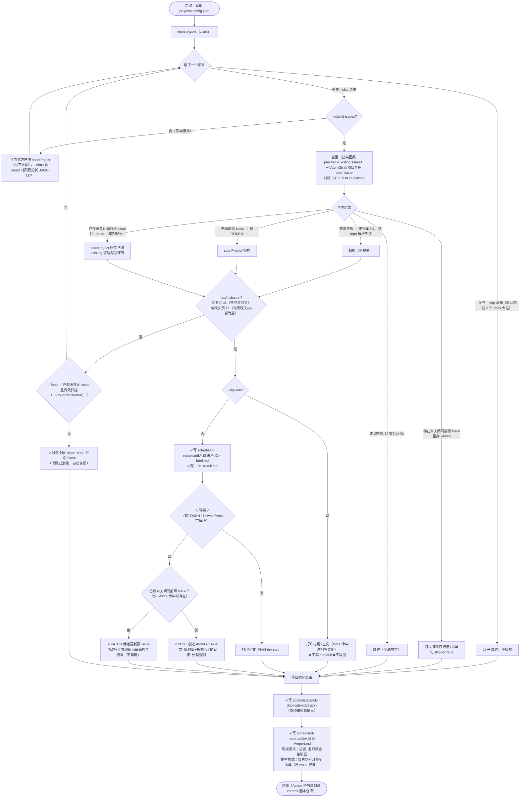
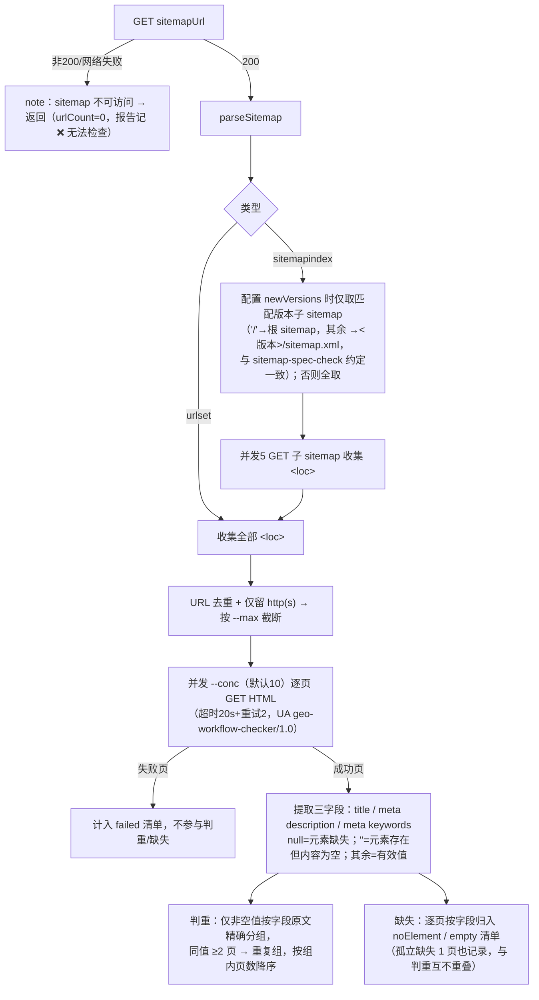

# TDK 工具与脚本

## 相关脚本

| 脚本 | 路径 | 功能 | 使用方式 |
|------|------|------|----------|
| check-tdk | scripts/checks/check-tdk.mjs | 校验各项目页面 title/description/keywords 的存在性与唯一性 | `node scripts/checks/check-tdk.mjs` |
| check-tdk-jsonld | scripts/checks/check-tdk-jsonld.mjs | TDK 重复 + JSON-LD 规范**合并全量检查**（2026-10 由 check-tdk-duplicate.mjs 与 check-jsonld.mjs 合并）：按 sitemap 全量页面逐页请求 HTML（每页只抓一次，两维度共用），TDK 维度检查重复项（非空值分组判重，逻辑参考 seo-check/scripts/description-check.js）与缺失项（逐页区分元素缺失/内容为空）；`--dims=tdk` 只跑本维度；`--submit-issues` 模式按前缀 `[GEO TDK Duplicate]` 查重后向各项目 AtomGit 仓库提单（`--force` 强制执行时对原未关闭 issue 更新/关闭写回） | `node scripts/checks/check-tdk-jsonld.mjs --dims=tdk [--site=ID] [--conc=10] [--max=N] [--skip=a,b] [--submit-issues] [--dry-run] [--force]` |
| atomgit 客户端 | scripts/lib/atomgit.mjs | AtomGit API v5 轻量封装（列 issue/按前缀查重/建 issue/更新 issue PATCH/评论），零依赖基于全局 fetch；并含 6 维度共用的提单流程实现：`precheckExistingIssues`（扫描前查重，force 不拦截）与 `reconcileIssue`（扫描后新建/就地更新/评论 `/close` 写回） | 供 `--submit-issues` 模式使用 |

## 使用说明

```bash
# 检查所有项目
node scripts/checks/check-tdk.mjs

# 检查单个项目
node scripts/checks/check-tdk.mjs --site openEuler-portal

# TDK 重复检查（2026-10 起与 JSON-LD 合并为 check-tdk-jsonld.mjs，共用 sitemap 全量抓取；--dims=tdk 只跑本维度；
# 默认跳过 openEuler-docs/openGauss-docs/MindSpore-docs 三个 docs 大站，--skip= 传空可全查）
node scripts/checks/check-tdk-jsonld.mjs --dims=tdk

# 只查单个项目 / 限制页数试跑
node scripts/checks/check-tdk-jsonld.mjs --dims=tdk --site=HiFloat
node scripts/checks/check-tdk-jsonld.mjs --dims=tdk --site=openEuler-portal --max=200

# 定时提 issue 模式（GitHub Actions 中执行；需 ATOMGIT_TOKEN；本地试跑可用 --dry-run 只打印正文）
node scripts/checks/check-tdk-jsonld.mjs --dims=tdk --submit-issues [--site=ID] [--dry-run]

# 强制执行（修复后立即复核：已有未关闭 issue 不再跳过，仍有问题更新原 issue，已无问题评论 /close）
node scripts/checks/check-tdk-jsonld.mjs --dims=tdk --submit-issues --force --site=HiFloat
```

## check-tdk-jsonld（TDK 维度）参数

### CLI 参数

| 参数 | 缺省值 | 含义 |
|------|--------|------|
| `--dims=<d1,d2>` | `tdk,jsonld` | 本次执行的维度；仅含 `tdk` 时只输出 TDK 的 stats/报告（JSON-LD 维度产物不动）；两维度同跑时共用同一份逐页抓取 |
| `--site=<项目ID>` | 不传 = 全部项目 | 只检查指定 id 的项目（大小写不敏感）。注意：id 不存在时 `filterProjects` 回退为全量检查 |
| `--skip=<id1,id2>` | 不传 = 默认跳过 `openEuler-docs`、`openGauss-docs`、`MindSpore-docs`（docs 大站页面量级大，历史版本/多语言同页 TDK 同值属预期） | 跳过清单（逗号分隔，大小写不敏感）；被跳过项目只进报告记 ⏭️，不扫描、不提单。`--skip=` 传空 = 取消默认跳过，强制全查 |
| `--conc=N` | `10` | 逐页抓取 HTML 的并发数 |
| `--max=N` | 不截断 | 每项目页面全集截断为前 N 个（试跑用），截断情况写入 notes 与报告 |
| `--submit-issues` | 关闭 | 提 issue 模式：逐项目先查重（AtomGit 仓库标题前缀 `[GEO TDK Duplicate]` 的未关闭 issue）→ 命中且**非** `--force` 则跳过该项目"扫描+提单"全流程；未命中则扫描，有重复或缺失时写 `<ID>-brief.md`/`<ID>-full.md` 并提单；汇总 report.md 切换为"仅总览 + full 指针（含 issue 链接）"，不重复输出明细 |
| `--dry-run` | 关闭 | 仅配合 `--submit-issues` 有意义：不写 brief/full、绝不提单，只把将要提交的 issue 标题与正文打印到控制台（汇总/stats 照常输出） |
| `--force` | 关闭 | 仅配合 `--submit-issues` 有意义（对应 workflow 的 `force_check` 输入）：**强制执行**——查重命中已有未关闭 issue 时不再跳过，照常扫描：① 仍有重复/缺失 → 就地 PATCH 更新原 issue 标题与正文（不新建，`updated`）；② 问题已全部消除且本次为有效扫描（`urlCount>0` 且 `fetched>0`）→ 对每个原未关闭 issue 评论 `/close` 自动关闭（`close-commented`）；无原 issue 时行为同默认提单流程（新建）。dry-run/无 token 仅打印将执行的动作 |

### 环境变量

| 变量 | 缺省 | 作用 |
|------|------|------|
| `ATOMGIT_TOKEN` | 未设置 | AtomGit 写操作凭证。未设置时所有项目 `canSubmit=false`：本地试跑只会扫描+打印正文，**不会提单**；提单模式查重失败时（无 token）也降级为仅扫描 |
| `GITHUB_REPOSITORY` | `opensourceways/daily-check-workflow` | issue 正文中完全版报告链接的仓库路径 |
| `GITHUB_REF_NAME` | `archive` | 链接中的分支名（GitHub Actions 运行时自动注入实际值） |

## check-tdk-jsonld（TDK 维度）执行流程



单项目扫描内部（scanProject，两种模式共用；TDK/JSON-LD 两维度共用同一份逐页抓取）：



> 触发提单条件 `hasAnyIssue` = 任一字段重复组 ≥1 或缺失页 ≥1；docs 大站默认跳过 + 每周一次的频率控制成本（全量约 6000+ 页/次，与 JSON-LD 维度共用同一份抓取，不新增请求量）。缺失值已从判重中剥离——历史版本"(缺失)"伪重复组不再产生。

## GitHub Action

- 编排：`.github/workflows/tdk-jsonld-check.yml`（2026-10 与 JSON-LD 维度合并，原 tdk-duplicate-check.yml 已删除）
- 触发：每周一 03:30 UTC（北京时间 11:30）schedule + workflow_dispatch（inputs：`site`、`dims`（both/tdk/jsonld）、`dry_run`、`force_check`——勾选后透传 `--force` 强制执行，跳过查重拦截并写回原 issue）
- 运行：`node scripts/checks/check-tdk-jsonld.mjs --submit-issues`（默认双维度共用抓取，`--dims=tdk` 只跑本维度），env `ATOMGIT_TOKEN: ${{ secrets.ATOMGIT_TOKEN }}`
- 产物回写：`scheduled-reports/tdk/<YYYY-MM-DD>/`（report.md 与各项目 brief/full；合并运行时另 commit `scheduled-reports/jsonld/<YYYY-MM-DD>/`）由 Action commit 回本仓库，issue 内完全版报告链接据此解析
- 注意：schedule cron 仅在默认分支（main）生效

## 输出

- 汇总报告：`scheduled-reports/tdk/YYYY-MM-DD/report.md`（按日期分目录；手动模式含全部明细，`--submit-issues` 模式仅含总览 + 指向各项目完全版文件的清单）
- 完整重复组与缺失数据：`scripts/stats/tdk-duplicate-stats.json`
- `--submit-issues` 模式额外输出（每项目，仅当发现重复或缺失）：`scheduled-reports/tdk/<日期目录>/<ID>-brief.md`（简短版，issue 正文用）与 `<ID>-full.md`（完全版，含重复全部 URL 与缺失逐页清单，issue 链接指向它，由 workflow 提交回仓库）
