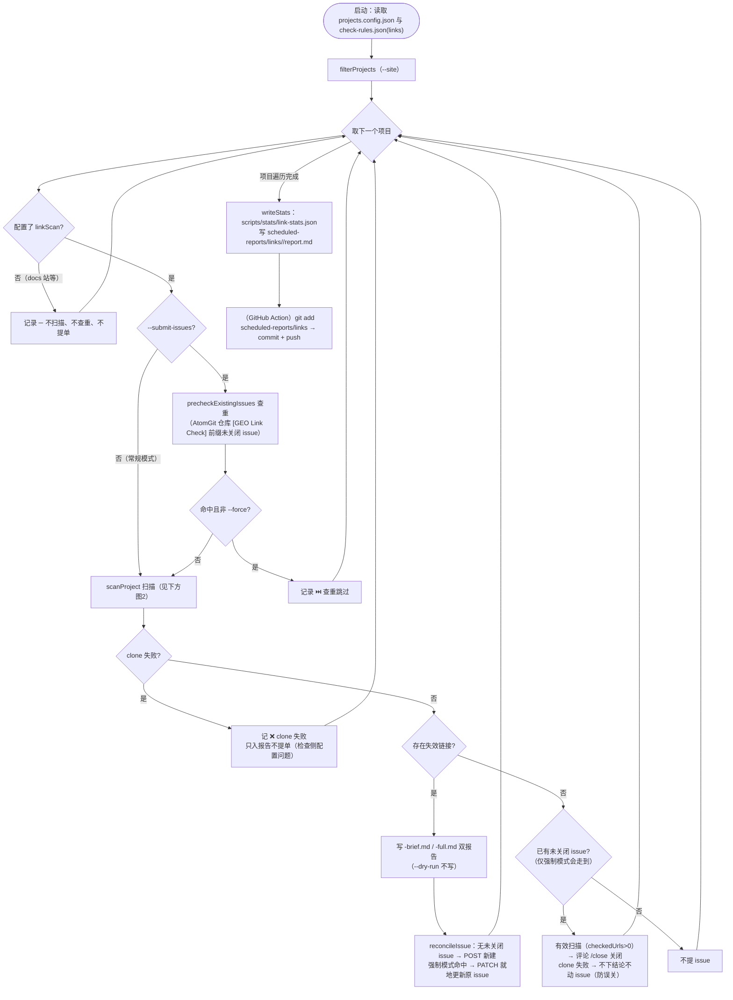
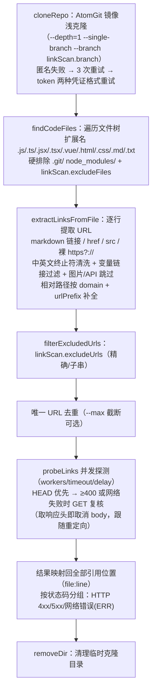

# 失效链接（死链）工具与脚本

## 相关脚本

| 脚本 | 路径 | 功能 | 使用方式 |
|------|------|------|----------|
| check-links | scripts/checks/check-links.mjs | 失效链接维度脚本：按 projects.config.json 中配置了 `linkScan` 的项目逐个执行「clone 源码仓（AtomGit 镜像浅克隆）→ 扫描源码提取 URL → 唯一去重后并发 HEAD/GET 探测」，输出 stats JSON + `scheduled-reports/links/YYYY-MM-DD/`（report.md 汇总 + `<ID>-brief.md`/`<ID>-full.md` 双报告）；`--submit-issues` 时按查重结果向各项目 AtomGit 仓库提 issue（前缀 `[GEO Link Check]`，每项目至多一个） | `node scripts/checks/check-links.mjs` |
| link-scan | scripts/lib/link-scan.mjs | 死链检测支撑库：URL 提取/清洗/变量过滤（markdown 链接、href、src、裸链接；中英文终止符、HTML 实体、未闭合括号）、相对路径补全（domain + urlPrefix）、排除规则、HEAD→GET 探测（零依赖全局 fetch）、并发调度、clone（浅克隆 + 重试 + token 认证）与临时目录清理 | 由 check-links.mjs 引用 |

## GitHub Action

- `.github/workflows/link-check.yml`：每周一 06:30 UTC 定时（重成本维度，错开周一 03:30 的 TDK/JSON-LD 全量抓取与每日 04:00~05:00 轻量维度、06:00 看板）+ 手动 dispatch（inputs：`site`、`dry_run`、`force_check`——勾选后透传 `--force` 强制执行，跳过查重拦截并写回原 issue）；`--submit-issues` 模式运行，超时 90 分钟；当日报告 commit 回本仓库
- **提单账号独立**：本维度与其他维度不同，用的是独立 secret `ATOMGIT_LINKS_TOKEN`（其他维度仍用 `ATOMGIT_TOKEN`，即原提单账号）；workflow 内将其映射到脚本认的 `ATOMGIT_TOKEN` 环境变量，公共实现零改动。该 secret 未配置时为空 token → 各项目自动降级为"只扫描、查重失败不提单"，不会误用其他账号提单。该账号需能读 4 个目标仓库（查重列 issue + clone 受限镜像仓 + 提 issue），首次启用建议先 dry_run 验证

## 使用说明

```bash
# 检查所有配置了 linkScan 的项目（常规，不提单）
node scripts/checks/check-links.mjs

# 检查单个项目
node scripts/checks/check-links.mjs --site=openEuler-portal

# 试跑：限制每项目最多探测 50 个唯一 URL（验证流程用）
node scripts/checks/check-links.mjs --site=openEuler-portal --max=50

# 提高探测并发（默认 5，来自 check-rules.json 的 links.workers）
node scripts/checks/check-links.mjs --conc=10

# 扫描并向各项目 AtomGit 仓库提 issue（本地无 ATOMGIT_TOKEN 时自动降级为只扫描打印正文）
ATOMGIT_TOKEN=xxx node scripts/checks/check-links.mjs --submit-issues

# 试运行：扫描 + 打印 issue 正文，不提 issue、不写 brief/full（汇总报告仍生成）
node scripts/checks/check-links.mjs --submit-issues --dry-run --site=openEuler-portal

# 强制执行（修复后立即复核：已有未关闭 issue 不再跳过，仍有问题更新原 issue，已无问题评论 /close）
node scripts/checks/check-links.mjs --submit-issues --force --site=openEuler-portal
```

本地试跑注意：clone 走 AtomGit 镜像（公开仓匿名可拉，openEuler-portal 浅克隆约 2GB/2 分钟）；MindSpore-portal、openUBMC-portal 的镜像仓匿名不可见，本地无 token 时这两个项目会记 clone 失败（不提单），属预期。

## check-links 参数

### CLI 参数

| 参数 | 缺省值 | 含义 |
|------|--------|------|
| `--site=<项目ID>` | 不传 = 全部项目 | 只检查指定 id 的项目（大小写不敏感；仅对配置了 `linkScan` 的项目生效）。注意：id 不存在时 `filterProjects` 回退为全量检查 |
| `--conc=<N>` | `check-rules.json` 的 `links.workers`（5） | 探测并发数。链接探测为 IO 密集，可按网络情况上调 |
| `--max=<N>` | 不截断 | 每项目最多探测的唯一 URL 数（试跑截断验证流程用，正常定时运行不传） |
| `--submit-issues` | 关闭 | 提 issue 模式：逐项目先查重（AtomGit 仓库标题前缀 `[GEO Link Check]` 的未关闭 issue）→ 命中且**非** `--force` 则跳过该项目"扫描+提单"；未命中则扫描，存在失效链接时写 brief/full 双报告并提单 |
| `--dry-run` | 关闭 | 仅配合 `--submit-issues` 有意义：绝不提单，只打印将要提交的 issue 标题与正文（汇总/stats 照常输出，不写 brief/full） |
| `--force` | 关闭 | 仅配合 `--submit-issues` 有意义（对应 workflow 的 `force_check` 输入）：**强制执行**——查重命中已有未关闭 issue 时不再跳过，照常扫描：① 仍有失效链接 → 就地 PATCH 更新原 issue 标题与正文（不新建）；② 失效链接已消除且本轮为有效扫描（clone 成功且探测了 ≥1 个 URL）→ 对每个原未关闭 issue 评论 `/close` 自动关闭。clone 失败（判不了"已修复"）只记日志不动原 issue，防误关 |

### 环境变量

| 变量 | 缺省 | 作用 |
|------|------|------|
| `ATOMGIT_TOKEN` | 未设置 | 三重用途：① clone 受限镜像仓的认证（匿名失败后按「token 作用户名」「oauth2:token」两种格式重试）；② issue 查重/提单的写操作凭证，**issue 与 /close 评论均以该 token 所属 AtomGit 账号名义提交**。未设置时：公开仓仍可匿名 clone 并扫描，但所有项目 `canSubmit=false` 不提单。**CI 中由 workflow 从独立 secret `ATOMGIT_LINKS_TOKEN` 注入**（区别于其他维度的 `ATOMGIT_TOKEN`，见上）；本地运行可直接 `ATOMGIT_TOKEN=xxx node ...` 指定任意账号 |
| `GITCODE_TOKEN` | 未设置 | clone 认证的备选 token（与 ATOMGIT_TOKEN 二者取一） |
| `GITHUB_REPOSITORY` | `opensourceways/daily-check-workflow` | issue 正文尾部当日汇总报告链接的仓库路径 |
| `GITHUB_REF_NAME` | `main` | 报告链接中的分支名（GitHub Actions 运行时自动注入实际值） |

### 配置文件

| 文件 | 位置 | 内容 |
|------|------|------|
| `linkScan` 字段 | projects.config.json（逐项目） | `branch`（克隆分支）、`urlPrefix`（相对路径前缀，如 openEuler 的 `/zh`）、`excludeFiles`（相对路径子串排除；`.git/`、`node_modules/` 内置硬排除）、`excludeDomains`（域名及子域排除）、`excludeUrls`（精确或子串排除，用于运行时拼接的已知误报 URL） |
| `links` 段 | scripts/config/check-rules.json | 探测参数：`workers`（并发，默认 5）、`timeoutSeconds`（默认 15）、`delaySeconds`（每任务随机抖动上限，默认 0.5） |

## check-links 执行流程




